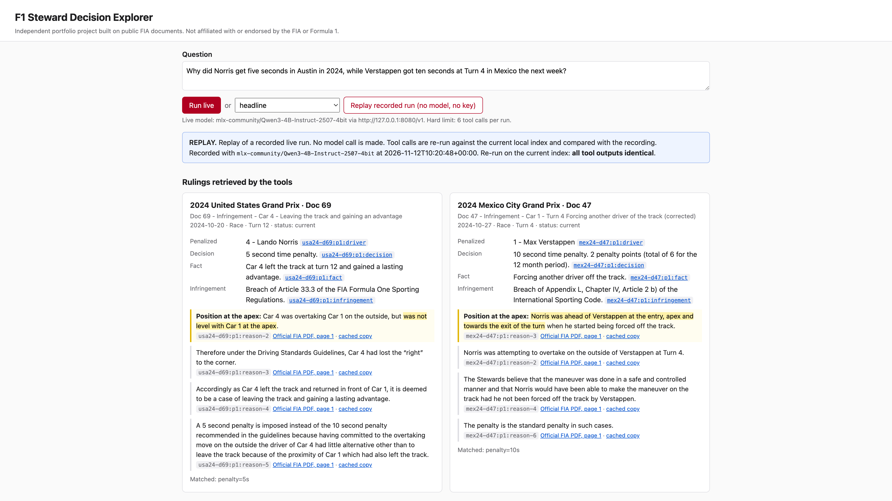
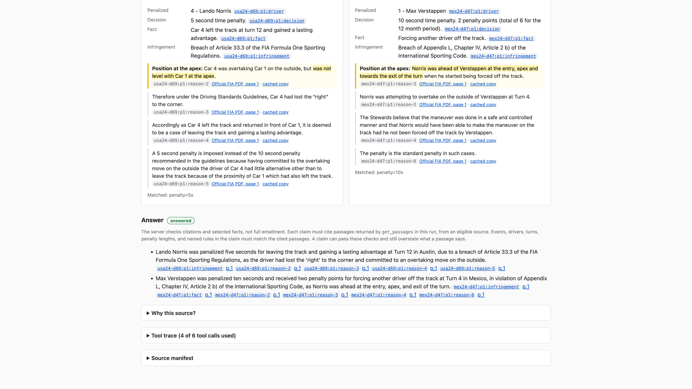
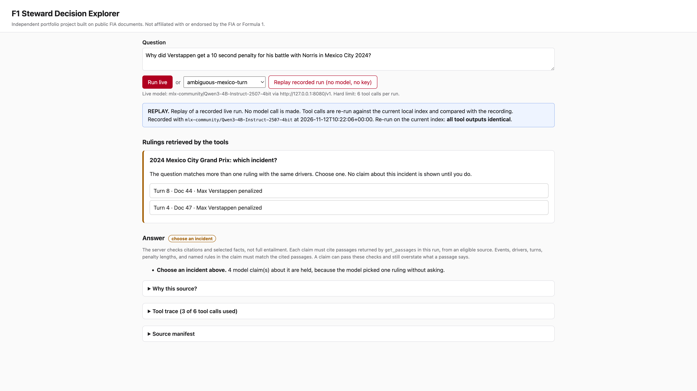
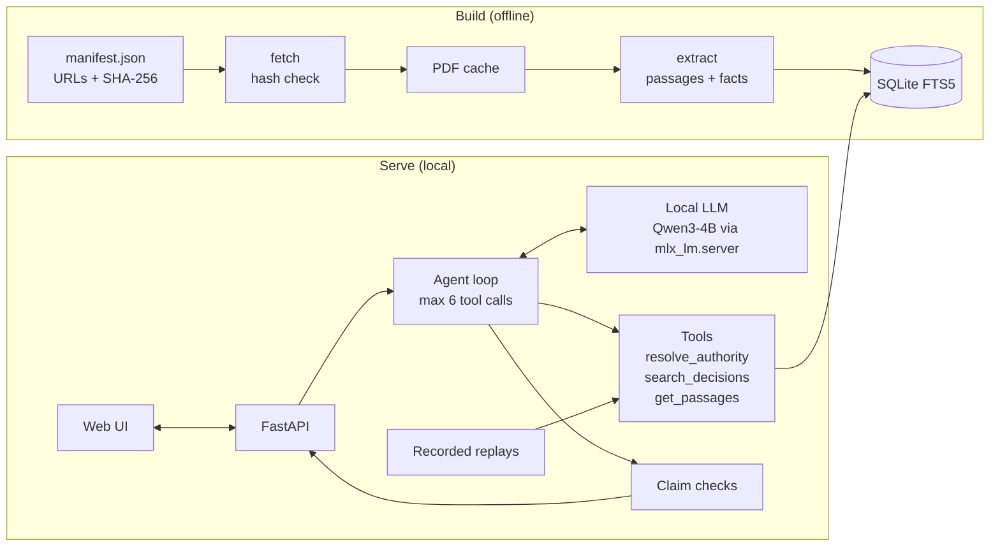

# F1 Steward Decision Explorer

A tool-using LLM app that answers questions from a small set of source documents and shows
its evidence. Every claim cites a passage it retrieved in that run, and the server removes
claims that fail its checks.

The corpus is 18 public FIA documents from two 2024 Formula 1 races. The goal is a small,
fully testable system: pinned sources, deterministic retrieval, a local 4B model, recorded
replays, and an eval with held-out queries.



## Demo

The app runs locally. Recorded runs replay without a model or API key.

**1. Ask a comparison question.** "Why did Norris get five seconds in Austin while Verstappen
got ten in Mexico?" The model calls the tools and retrieves one ruling for each race. The
passages that explain the difference are highlighted (screenshot above).

**2. Read the checked answer.** Each claim links to the passages it cites. The tool trace and
the reason each source was chosen or rejected are one click away.



**3. Ambiguous questions stop and ask.** The same two drivers have two rulings at different
corners in Mexico. The model picked one without asking. The server holds its claims and asks
the user to choose.



## Architecture



- **Sources.** Each document is pinned by URL and SHA-256. `fetch` refuses a file whose hash
  does not match.
- **Retrieval.** Hard filters run first (version, date, event, drivers, turn), then BM25,
  then a score for matching incident facts. Recalled or superseded documents never rank.
- **Tools.** The model can only call three server-side tools. The server enforces the call
  budget, retries malformed calls, and records every call.
- **Claim checks.** A claim must cite passages returned in this run, from an eligible
  source, and its drivers, turns, numbers, and named rules must match the cited text.
- **Replays.** A recorded run re-executes its tool calls against the current index and
  reports whether the outputs are identical. This makes regressions visible without a model.

## Results

12 labeled queries: 8 for tuning, 4 held out and run once.

| Method | hit@3 dev | hit@3 held-out | Wrong source in top 3 |
|---|---|---|---|
| BM25 only | 4/8 | 2/4 | 8/12 |
| + version/date filters | 8/8 | 4/4 | 1/12 |
| + incident facts | 8/8 | 4/4 | 0/12 |

Retrieval takes under 1 ms per query. A live run with the 4B model takes 40–80 s on a laptop.
This is a small corpus. The results show the checks work, not that the ranking generalizes.

## Stack

Python 3.11, FastAPI, SQLite FTS5, pypdf, vanilla JS, `mlx_lm.server` (any OpenAI-compatible
endpoint with tool calls works), pytest, ruff, uv.

## Run it

```bash
git clone https://github.com/Vikramansen/f1-steward-explorer.git
cd f1-steward-explorer
uv sync
uv run steward fetch    # download and hash-check the PDFs
uv run steward build    # build the SQLite index
uv run steward serve    # http://127.0.0.1:8000
```

Pick a recorded run in the UI and click **Replay**. To run live, start a local model server
first (see the engineering notes).

## More

[Engineering notes](docs/engineering.md): sources, design, eval details, model failures,
and limitations.
